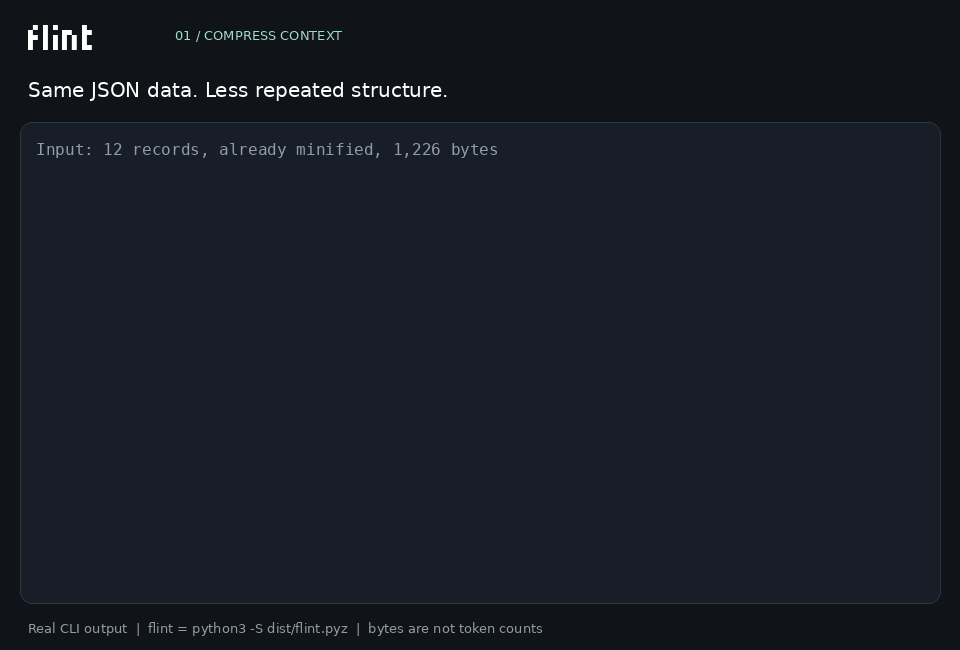

# Flint

[English](README.md) | **Italiano**


**Contesto più compatto. Informazioni conservate.**

Flint offre agli agenti AI strumenti per comprimere codice, JSON e testo,
gestire il contesto utile, ricordare decisioni e recuperare i contenuti originali.
Letture mirate e modifiche legate alla versione del file permettono di usare
quel contesto per intervenire sul codice.

Opera tra l'agente e i suoi strumenti: collega la CLI o l'interfaccia JSON al
tuo flusso di lavoro, indipendentemente dal modello o dal provider.
**Python 3.11+ · Linux / WSL · motore basato sulla libreria standard ·
nessun modello o server richiesto.**

**[Installa Flint](#installazione) · [Scarica il file pronto](https://github.com/JustVugg/flint/raw/refs/heads/main/dist/flint.pyz)**

## Guardalo in azione



La GIF esegue comandi reali sugli [esempi inclusi](examples/):

1. **Comprimi il contesto:** 12 record JSON già minificati passano da **1.226 a
   499 byte**, includendo i metadati di formato: **59,3% di byte in meno in questo esempio**.
2. **Recupera le informazioni:** tutti i 12 record e ogni valore JSON vengono ripristinati.
3. **Leggi e modifica il codice:** apri il sorgente esatto e invia soltanto la riga cambiata.
4. **Conserva le decisioni:** salva una decisione e richiamala in una chiamata successiva.

Sono byte di questo esempio, non token del modello né un risparmio garantito
per ogni input. [Comandi eseguiti e risultati](assets/demo/recording.json).
Nella GIF `flint` abbrevia `python3 -S dist/flint.pyz`.

## Cosa fa Flint

| Funzione | Come aiuta un agente |
|---|---|
| Compressione reversibile | Rappresenta in modo compatto le ripetizioni di codice, JSON e testo, con decodifica esplicita. |
| Recupero esatto | Recupera originali conservati e intervalli di codice quando serve il contenuto completo. |
| Contesto mirato | Legge definizioni Python complete, intervalli di righe o corrispondenze testuali. |
| Composizione del contesto | Riunisce fonti selezionate e dipendenze dichiarate entro un budget di byte. |
| Memoria persistente | Conserva decisioni, permette di cercarle e mantiene le versioni precedenti. |
| Controllo delle fonti | Esclude le memorie collegate a file cambiati o mancanti. |
| Modifiche legate alla revisione | Applica una modifica soltanto alla versione letta dall'agente. |
| Riletture incrementali | Restituisce le differenze rispetto a una versione completa e confermata. |

I codec JSON reversibili conservano i valori; i codec per codice e testo possono
ricostruire il contenuto esatto. Le viste selezionano cosa mostrare, mentre gli
originali conservati rimangono recuperabili. Sono operazioni diverse: un estratto
selezionato non equivale all'intero file. La riscrittura opzionale della prosa
è separata dalla codifica reversibile.

## Installazione

**Python 3.11+ su Linux o WSL. Nessuna build, pacchetto pip o modello da scaricare.**

[Scarica lo ZIP](https://github.com/JustVugg/flint/archive/refs/heads/main.zip),
estrailo ed esegui questo comando dalla cartella estratta:

```bash
python3 install.py
```

Scegli Codex, Claude Code, entrambi o soltanto la CLI. L'installer copia il
pacchetto pronto e configura le skill utente degli agenti scelti. Conserva le
impostazioni esistenti e rifiuta di sostituire comandi estranei o skill modificate.

Preferisci un solo file? [Scarica flint.pyz](https://github.com/JustVugg/flint/raw/refs/heads/main/dist/flint.pyz)
ed esegui `python3 flint.pyz install`. Skill e licenze sono già incluse.

Il comando viene installato in `~/.local/bin/flint`. Se la cartella non è nel
PATH, l'installer mostra la riga `export PATH=...` da eseguire e aggiungere al
profilo della shell. Le skill hanno un proprio comando di avvio e funzionano
anche senza questa modifica al PATH. Riavvia l'agente per rilevare la skill,
poi chiedigli di usare Flint per il tuo progetto.

```bash
flint doctor
flint --workspace /percorso/del/progetto work open src/esempio.py
```

`doctor` controlla installazione, skill, compressione, recupero, modifiche e
memoria in un workspace temporaneo. Non chiama modelli e non modifica il tuo
progetto. La skill rende Flint disponibile all'agente: non intercetta
automaticamente tutti gli strumenti e non cambia il modello.

### Configurare, aggiornare o rimuovere

```bash
# Scegli un agente senza il menu interattivo.
python3 install.py --agent codex

# Aggiungi la skill soltanto a un progetto; per Claude Code usa --agent claude.
flint setup --agent codex --project /percorso/del/progetto

# Un altro agente compatibile con SKILL.md: indica la sua cartella delle skill.
flint setup --skill-dir /percorso/alle/skill

# Mostra le modifiche previste o controlla l'installazione.
python3 install.py --agent both --dry-run
flint doctor --json

# Rimuovi Flint e le sue skill inalterate; conserva progetti e memorie.
flint uninstall --yes
```

Per aggiornare, scarica il nuovo ZIP o `.pyz` ed esegui nuovamente l'installer.
Vengono aggiornate anche le skill registrate. Flint non sovrascrive i file gestiti
che hai modificato: salva le tue modifiche separatamente e ripristina l'originale
prima di riprovare.
`--prefix /percorso` sceglie un'altra cartella d'installazione. La configurazione
utente rispetta `CODEX_HOME` e `CLAUDE_CONFIG_DIR`; quella di progetto usa
`.agents/skills` per Codex e `.claude/skills` per Claude Code. Sono supportate
anche cartelle delle skill personalizzate.

Per provare Flint senza installarlo, dalla cartella del repository esegui:

```bash
python3 -S dist/flint.pyz --workspace . work open examples/hello.py
```

Gli esempi seguenti usano il pacchetto portabile; dopo l'installazione puoi
sostituire `python3 -S dist/flint.pyz` con `flint`.

### Comprimi e ripristina JSON

```bash
python3 -S dist/flint.pyz encode examples/records.json --format columns --report > packed.txt 2> packed.meta.json
python3 -S dist/flint.pyz decode packed.txt --format json-columns
```

L'esempio usa `json-columns`: campi ricorrenti, valori costanti e sequenze
numeriche condividono una rappresentazione compatta. Per altri input usa il
formato indicato in `packed.meta.json` durante la decodifica.
`encode --format auto` sceglie tra i candidati supportati in base ai byte.
COPY e template per codice/testo sono opzioni esplicite:
[documentazione dei codec](integrations/skills/flint-context/references/advanced-context.md).

### Invia soltanto la modifica

```bash
python3 -S dist/flint.pyz --workspace . work open examples/hello.py
```

Il risultato include un ticket, per esempio `W1 e1 source`. Salva questo piano
come `edit.json` per sostituire la seconda riga dell'esempio:

```json
{"edits":[[2,1,"    return f'Ciao, {name}!'\n"]]}
```

```bash
python3 -S dist/flint.pyz --workspace . work edit e1 edit.json
```

Usa il ticket restituito dalla tua chiamata: `e1` è illustrativo. Flint rifiuta
la scrittura se il sorgente è cambiato. Le modifiche riuscite restituiscono un
nuovo ticket; `work show TICKET` ne recupera il contenuto. Una proposta Python
con sintassi errata può restare disponibile per la correzione, mantenendo
intatto il file originale.

Per gli agenti che inviano JSON:

```bash
printf '%s\n' '{"op":"open","path":"examples/hello.py"}' |
  python3 -S dist/flint.pyz --workspace . work call
```

[Interfaccia JSON e ticket](integrations/skills/flint-context/references/work-tickets.md).

### Ricorda una decisione

```bash
python3 -S dist/flint.pyz --workspace . memory remember examples/decisions.txt --key project-decisions
python3 -S dist/flint.pyz --workspace . memory recall 'project decisions' --budget 8192 --compact
python3 -S dist/flint.pyz --workspace . memory history project-decisions
```

Registrare una nota cambiata con la stessa chiave aggiorna la memoria corrente
e conserva lo storico. `memory recover RIFERIMENTO` recupera un originale.
La ricerca è lessicale e restituisce memorie complete entro il budget di byte.

Aggiungi `--track-source` quando una memoria deve restare corrente soltanto
finché il file originale non cambia. Le fonti cambiate o mancanti sono
segnalate come obsolete ed escluse dai richiami correnti. Leggi la nuova fonte
prima di aggiornare la memoria.

[Memoria e sessioni](integrations/skills/flint-context/references/memory-wire.md).

### Leggi il codice pertinente

```bash
python3 -S dist/flint.pyz --workspace . map examples/hello.py
python3 -S dist/flint.pyz --workspace . inspect examples/hello.py greet --editable
```

Le selezioni conservano il sorgente esatto. I budget sono byte UTF-8. Un budget
insufficiente viene segnalato, senza restituire silenziosamente una selezione
incompleta. Dopo un cambio di contesto avvia una nuova sessione e recupera le
fonti necessarie al lavoro.

## Più veloce nella versione 0.18

Il percorso JSON carica l'editor soltanto quando serve e riduce il lavoro
iniziale della CLI, mantenendo invariati risposte e controlli di revisione.

| Operazione JSON sullo stesso file Python | 0.17 | 0.18 | Tempo in meno |
|---|---:|---:|---:|
| Aprire un file | 62,12 ms | **45,64 ms** | **26,5%** |
| Recuperare il contenuto di un ticket | 66,97 ms | **48,65 ms** | **27,4%** |
| Applicare una modifica | 103,58 ms | **84,95 ms** | **18,0%** |

Mediane di 12 esecuzioni per versione e operazione, sullo stesso sistema Linux
e con lo stesso interprete Python. Su tre input le riduzioni osservate sono
**26–30% per lettura e recupero JSON** e **17–22% per le modifiche**.
Sono tempi degli strumenti: tempo complessivo e consumo di token dell'agente
dipendono dal compito e dall'integrazione.

## Integrazione e distribuzione

La [skill Flint Context](integrations/skills/flint-context/SKILL.md) descrive
quando leggere, comprimere, ricordare, recuperare e modificare. Gli agenti
possono anche richiamare direttamente la CLI o l'interfaccia JSON.
L'agente decide quali operazioni usare.

Lo stato del workspace risiede in `.flint/`, esclusa da Git. I riferimenti
appartengono a quel workspace. I codec opzionali e il motore C COPY/1 sono
illustrati nelle [operazioni avanzate](integrations/skills/flint-context/references/advanced-context.md).

- [Motore Python](flint/), [CLI](bin/flint) e [pacchetto pronto](dist/flint.pyz).
- [Hash dei sorgenti e manifest](dist/manifest.json).
- [Motore C opzionale](native/flint_copy.c).
- [Logo, font e varianti del marchio](assets/preview.html).

Ricostruisci il pacchetto senza scaricare dipendenze:

```bash
python3 tools/package.py
```

## Licenza

Flint è distribuito con [licenza Apache 2.0](LICENSE). Le attribuzioni sono
riportate in [NOTICE](NOTICE). Entrambi i file sono inclusi nel pacchetto pronto.

Le attribuzioni e le licenze dei componenti adattati sono conservate in
`vendor/` e nel pacchetto. Micro 5 include la propria
[licenza OFL](assets/fonts/OFL.txt).
